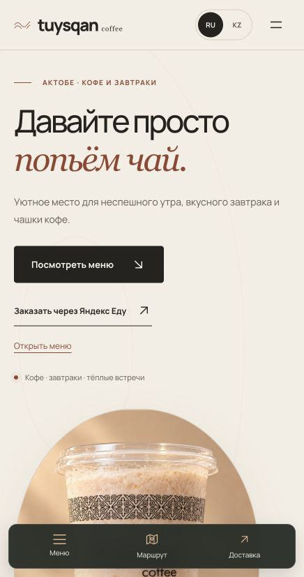

# Tuysqan Coffee System

Система для кофейни на Django: витрина с меню, заказы по QR-коду столика, касса, экран кухни и кабинет владельца.

| Раздел | Адрес на локальном сервере |
| --- | --- |
| Витрина | `/` |
| Вход сотрудников | `/admin/login/` |
| Касса | `/admin/cashier/` |
| Экран кухни | `/admin/kitchen/` |
| Кабинет владельца | `/admin/` |

## Локальный запуск

Нужен Python 3.11. На macOS и Linux выполни из корня проекта:

```bash
python3.11 -m venv .venv
source .venv/bin/activate
python -m pip install -r requirements.txt
python manage.py migrate
python manage.py setup_local
python manage.py import_drinks
python scripts/build_drinks_landing.py
python manage.py runserver 127.0.0.1:8000
```

Открой [http://127.0.0.1:8000/](http://127.0.0.1:8000/). Команда `setup_local` создаёт локальные учётные записи `administrator`, `cashier` и `kitchen`. Их пароли сохраняются в `.local-credentials.json`. После клонирования база создаётся заново из миграций и файлов меню.

## Как работает проект

Главная страница — витрина без корзины. Оформление доступно через подписанный QR столика; произвольный номер столика не принимается. Владелец получает QR в настройках.

Вход сотрудников: /admin/login/ . Администратор: /admin/ , кассир: /admin/cashier/ , кухня: /admin/kitchen/ . Управление данными: /admin/manage/ . Учётные записи administrator, cashier, kitchen. Пароли находятся в локальном закрытом файле .local-credentials.json (не публиковать). setup_local сохраняет существующие пароли.

Файлы: templates/landing.html и static/landing — клиентская витрина; order-bridge — корзина QR; core/models.py, services.py, views.py — данные, операции и серверные проверки доступа. История оплат и готовность ведутся раздельно. Тестовые исторические записи сохранены с прежними флагами и исключены из рабочих очередей/продаж. Синтетические товары и старые аккаунты отключены.

Новые заказы обычные рабочие записи. Оплату отмечает сотрудник вручную. Реальные банковские API, SMS, Telegram и онлайн-ККМ не подключены. Локальная очередь уведомлений пока не отправляет сообщения Telegram. Подтверждение заказа не является фискальным чеком. Лояльность не активируется до согласования открытых правил. Концептуальные изображения продолжают обозначаться визуализациями.

Перед размещением на хостинге требуется отдельное согласование инфраструктуры, защищённого доступа и хранения персональных данных. QR с localhost подходит для просмотра на этом компьютере; для телефона нужен доступный телефону адрес сервера, который пока не настроен.

Проверки: `.venv/bin/python manage.py check`, `.venv/bin/python manage.py test`.

## Режим с подтверждением номера по SMS

Просмотр QR-меню и корзина доступны без входа. Перед оформлением клиент подтверждает номер SMS-кодом. Для существующего номера используется профиль из базы; новый клиент вводит имя и согласия после проверки кода. Комментарии к отдельным позициям не отправляются, общий комментарий заказа сохранён.

SMS-провайдер пока не выбран: SMS_BACKEND=disabled, запрос отвечает 503 без отправки и без ложного подтверждения. В режиме с обязательным SMS оформление недоступно, пока провайдер не подключён. Локальный сценарий без SMS описан ниже. Memory-транспорт предназначен только для автоматических тестов, не для клиентов.

59 предоставленных WebP сохранены в static/menu-upload-2026-11-06. 35 изображений связаны с товарами базы, ещё 2 с конкретными вариантами публичного меню. 22 файла пока не сопоставлены (включая 5 напитков): нужны точные позиции/цены. См. docs/menu-upload-mapping.md. Иллюстрации не обозначаются реальными фото подачи.

## Напитки

Две предоставленные страницы меню: data/drinks-page-a.json и drinks-page-b.json. 68 вариантов по объёмам,64 доступны;4 матча требуют уточнения. Импорт: manage.py import_drinks (сохраняет изменения владельца), экспорт интерфейса: scripts/build_drinks_landing.py. Напитки имеют kind=drink и поступают в кассу/бар, не на кухню. Цены фото приоритетны для зала; расхождения доставки описаны docs/yandex-drinks-comparison.md. Добавки сохранены как данные, пока не оформлены модификаторами заказа.

## Текущий клиентский сценарий без SMS

Перед оформлением требуется номер и согласие. Для нового номера — имя; существующее имя не возвращается и не изменяется. Номер является неподтверждённой заявкой на профиль, не авторизацией. Доступны только заказы, созданные в текущей сессии. Автоматическая скидка и накопления по таким заказам отключены независимо от прежнего подтверждения профиля; Order.customer_identity_verified сохраняет происхождение проверки. Подтверждение скидки кассиром — следующий этап, ещё не реализовано.

Лендинг открывает меню в своей секции #menu без отдельного ?view=menu; заказ только через подписанный QR столика. Для напитков без изображений, кроме лимонадов, используется стандартный фирменный стакан.

## Скриншот

**Витрина на телефоне**


